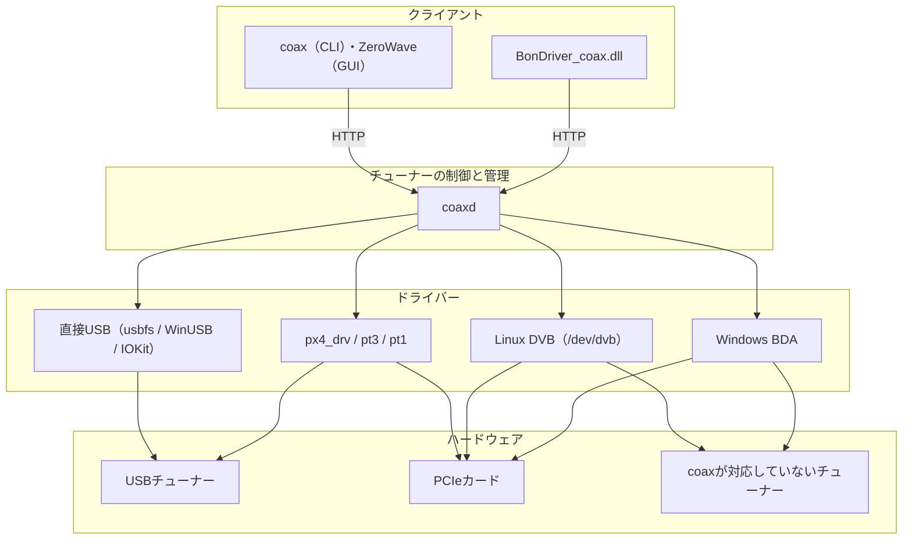

# coax

> **Sony torne（CECH-ZD1 J）の受信安定化フォークです。**
> [Till0196/coax](https://github.com/Till0196/coax) を元に、DiB8096の選局待機時間と受信失敗時の再探索を修正しました。
> Windowsの実機1台で、大阪・京都の主要局のフルセグと、13〜18ch・22〜26chの通常ワンセグを確認しています。
> 22ch（NHK神戸）・26ch（サンテレビ）は検証環境ではワンセグのみ確認できました。
> 修正内容・検証方法・制限は **[torne受信安定化の記録](docs/boards/cech-zd1j-stability.md)** を参照してください。
> ビルド済みの配布物は **[Releases](https://github.com/aki0429/coax/releases)** にあります。
> TVTestでサービス停止後に復帰できない場合の **[BonDriver再接続修正](docs/boards/cech-zd1j-reconnect.md)** も用意しています。

coaxは、チューナーを制御してストリームを取得するソフトウェアです。
USB（WinUSB、IOKit、usbfs）、Linux DVB API、Windows BDAといったOSごとの違いを内側で吸収し、どのプラットフォームでも同じ方法で選局とストリーミングができます。

coaxは2つのプログラムに分かれています。
チューナーとやり取りするのは、チューナーを管理するデーモンの`coaxd`だけです。
クライアントCLIの`coax`はチューナーを直接制御せず、HTTPで`coaxd`に選局を要求し、ストリームを受け取ります。
BonDriver実装の`BonDriver_coax`やGUIのZeroWaveも同じです。

### 構成

| プログラム | 役割 |
| --- | --- |
| `coax` | クライアントCLI。`list`、`tune`、`scan`、`export`、`card`の各サブコマンドを持ち、ハードウェアを直接制御しない |
| `coaxd` | チューナーホスト（デーモン）。チューナーを制御し、クライアントに貸し出す。チューナーもカードリーダーも1つのHTTP APIで提供する |
| [`BonDriver_coax`](https://github.com/Till0196/BonDriver_coax) | TVTestとEDCBのためのBonDriver。内蔵カードスロットをPC/SCで使うための`winscard.dll`と、TVTestプラグインを同梱 |
| `fwextract` | メーカー配布のドライバーパッケージからファームウェアを取り出す補助ツール |
| [ZeroWave](https://github.com/Till0196/ZeroWave) | GUIクライアント |

普段はデーモンの存在を意識する必要はありません。
`coaxd`が動いていなければ`coax`などのクライアントが起動し、誰も使わなくなれば`coaxd`は自動で終了します。
デーモンの動作の詳細は[tuner-host.md](docs/reference/tuner-host.md)にあります。

### できること

- **選局とストリーミング**：ISDB-T、ISDB-C、ITU-T J.83 Annex B、ISDB-S、ISDB-S3に加え、Linux DVB APIで表現できるDVB-T/T2、DVB-S/S2なども選局できます。
- **チャンネルとサービスのスキャン**：`coax scan --discover`は、内蔵の周波数リストを順に選局してNITを読み、その網のチャンネルを自動で組み立てます。定義ファイルを用意する必要はありません。PAT、NIT、SDTからサービス、Stream ID、ONIDを取り出します。周波数が事業者ごとに違うケーブルなどには、DVBv5形式のチャンネル定義ファイルも渡せます。
- **TSMFとTLVの解析**：1本の搬送波に複数のストリームがTSMFで多重されているときは、ヘッダーを読んでスロットごとに分け、それぞれの種別（TSかTLVか）とTSID、サービスを並べます。TLVは、パケット境界、IPv4/IPv6とヘッダー圧縮IP、UDP、MMTPヘッダー、分割や集約されたMMTシグナリング、TLV-NIT、MH-SDTまで解析します。TSMFに載ったTLVもPID `0x2d`からバイト列を組み直して同じ解析にかけます。
- **スキャン結果のエクスポート**：スキャン結果をMirakurunの`channels.yml`、DVBv5 conf、BonDriver ChSet、TVTest ch2、EDCB ChSet4/5へ変換します。
- **カードリーダー**：カードスロットを内蔵したチューナーなら、そのスロットをPC/SCソケット経由で使えます（[card-reader.md](docs/reference/card-reader.md)）。

### 対応チューナー

`coaxd`は、直接USB、`chardev`（px4_drv）、`pt3`と`pt1`、`dvb`（Linux DVB）、`bda`（Windows BDA）という複数の**バックエンド**を同時に持ち、見つかったチューナーを1つの一覧にまとめます。

そのため、coaxが個別に対応していないチューナーも使えます。
LinuxならLinux DVB API（`/dev/dvb`）、WindowsならBDAを通して、すでに入っているドライバーをそのまま使います（recpt1や製品ごとのBonDriverは不要です）。

coaxが個別に対応しているUSBチューナーは、放送用のドライバーを使わず、USBデバイスを直接制御します。
使うのはLinuxのusbfs、WindowsのWinUSB、macOSのIOKitで、どれもOSに元から入っているものです。
同じチューナーが、WindowsでもLinuxでもmacOSでも同じように動作します。

| ハードウェア | 例 | 通る経路 |
| --- | --- | --- |
| USB接続のチューナー | PLEX PX-W3U4、PX-S1UR、PX-W3U3、MyGica T230、KEIAN KTV-FSUSB2、TBS 5520SE、Sony CECH-ZD1 J | 直接USB。Linux、Windows、macOSのいずれでも動きます |
| PCIe接続のチューナー | Earthsoft PT3、PLEX PX-W3PE5、PX-MLT5PE、Digital Devices Max M4やPT4K(TBS6812)、その他TBSのPCIeカード | Linuxはpx4_drvやLinux DVB、Windowsは直接USBか、`coaxd`がカードを直接制御する経路 |
| coaxが対応していないチューナー | Linux DVBかBDAのドライバーがあるもの（一部の機能は使えません）| Linuxは`dvb`、Windowsは`bda` |

対応表と例外は[backends.md](docs/setup/backends.md)にあります。

### チャンネル選局とストリーム



クライアントはHTTPで選局を要求し、同じ接続でTSを受け取ります。
`coaxd`はチューナーを開いて選局し、受信したTSをその接続へ転送するだけです。
接続が閉じることがチューナーの解放そのものなので、解放の手続きは不要です。

どのドライバーを通るかは、チューナーごとのバックエンドで決まります。
既存のソフトウェアとの関係は[stack.md](docs/stack.md)にあります。

### ビルド

Go 1.25以降が必要です。
`coax`も`coaxd`も、Linux、Windows、macOSで`CGO_ENABLED=0`のままビルドできます（[getting-started.md](docs/setup/getting-started.md#1-フォルダを作る)）。

```sh
go build -o coax  ./cmd/coax
go build -o coaxd ./cmd/coaxd   # 同じディレクトリに置くと coax が自動で起動します
./coax version                  # coax 0.1.0
```

### 使い方

#### チューナーリスト（`coax list`）

USB接続のチューナーも、PCIeカードも、OSのドライバー経由のチューナーも、`coaxd`が同じ形にそろえて1つの一覧に並べます。
一覧を作るときにボードは開かないので、他のプログラムが使っているチューナーにも影響しません。
次はWindowsの例で、US-3POUT（USB）、TBS 6205se、Earthsoft PT3（どちらもPCIe）が1台に挿さっています。

```console
$ ./coax list
TUNER                   DELIVERY                                                    STATE  MODEL
us3pout:p9-16:0         ISDB-T, ISDB-S                                              free   US-3POUT (TC90522 + MxL136 + TDA20142)
tbs:5e0c2a7f19d34b81:0  DVB-T, DVB-T2, DVB-C, ISDB-T, DVB-C/ANNEX_B, DVB-C/ANNEX_A  free   TBS 6205se Tuner 0
tbs:5e0c2a7f19d34b82:0  DVB-T, DVB-T2, DVB-C, ISDB-T, DVB-C/ANNEX_B, DVB-C/ANNEX_A  free   TBS 6205se Tuner 1
tbs:5e0c2a7f19d34b83:0  DVB-T, DVB-T2, DVB-C, ISDB-T, DVB-C/ANNEX_B, DVB-C/ANNEX_A  free   TBS 6205se Tuner 2
tbs:5e0c2a7f19d34b84:0  DVB-T, DVB-T2, DVB-C, ISDB-T, DVB-C/ANNEX_B, DVB-C/ANNEX_A  free   TBS 6205se Tuner 3
pt3:6-17-0-0:0          ISDB-S                                                      free   Earthsoft PT3 satellite tuner 1
pt3:6-17-0-1:0          ISDB-S                                                      free   Earthsoft PT3 satellite tuner 2
pt3:6-17-0-2:0          ISDB-T                                                      free   Earthsoft PT3 terrestrial tuner 1
pt3:6-17-0-3:0          ISDB-T                                                      free   Earthsoft PT3 terrestrial tuner 2

Tuners are named from what each board reports about itself.
Pass --tuners to open each board and confirm them.
```

#### 1チャンネル受信する（`coax tune`）

`-o`で書き出し先を指定します。
省略すると標準出力へ出力します。

```sh
./coax tune --system ISDBT --ch 27 -o ter27.ts   # 地上デジタル27ch
./coax tune --ch BS15_1 -o bs.ts                 # 衛星（--ch 16625 でも同じチャンネル）
```

止めるときは`Ctrl-C`かSIGTERMを送ります。
接続が閉じることがチューナーの解放そのものなので、解放の手続きは不要です。

#### チャンネルリストを作る（`coax scan`と`coax export`）

`scan`で結果をJSONに保存し、`export`で各形式へ変換する2段です。
元になるのはJSONなので、書き出す形式や条件を変えてもスキャンし直す必要はありません。

```sh
./coax scan --discover --output scan.json                  # 受信できるチャンネルを探す
./coax export --input scan.json --output channels.yml      # Mirakurun形式へ変換
```

進捗は標準エラーへ出ます。
端末では最後の1行がその場で書き換わり、ファイルやパイプへリダイレクトすると候補ごとに1行ずつ出ます。
受信できたストリームは、サービスまで分かった時点で表示されます。

```console
$ ./coax scan --ch 27
[1/1] [##                  ]  12% locking  ISDBT/27 LOCK CNR 30.1dB (1.2s)
[1/1] [#####               ]  25% sampling ISDBT/27 15.98 Mbps CNR 29.6dB (3.3s)
[1/1] [####################] 100% done     ISDBT/27 found (ts, 4032224 bytes) 15.75 Mbps CNR 29.6dB (3.5s)
          サンプル6  TSID=32000  ONID=32000
            50000  サンプルテレビ1  (TV)
            50001  サンプルテレビ2  (TV)
            50007  サンプルテレビ臨時  (temporary video)
            50384  サンプルテレビ  (1seg)
```

1本の搬送波に複数のストリームがTSMFで多重されていることがあります。
その場合はスロットごとに分けてスキャンします。

```console
$ ./coax scan --discover ISDBC --route CATV --output scan.json
...
[46/113] [####################] 100% done     ISDBC/C46 found (ts, 33400824 bytes) 29.17 Mbps CNR 32.9dB -56dBm (9.8s)
    TSMF [#2 ts TSID=19001 ONID=4]
          BS Digital  TSID=19001  ONID=4
            291  サンプルBS  サンプル放送  (TV)
    TSMF [#3 ts TSID=19003 ONID=4]
          BS Digital  TSID=19003  ONID=4
            292  サンプルBS  サンプルテレビ  (TV)
...
```

TLVのスロットは種別が`tlv`になります。
1波に収まっているものは、TLVを解析してサービスまで表示します。

```console
$ ./coax scan --system ISDBC --ch C19 --route CATV
[1/1] [####################] 100% done     ISDBC/C19 found (ts, 9914352 bytes) 38.81 Mbps CNR 33.5dB -52dBm (9s)
    TSMF [#1 tlv TSID=45101 ONID=11]
            195  サンプルＢＳ　４Ｋ  サンプル放送  (TV)
```

1つのTLVストリームが複数の搬送波にまたがることもあります。
次の3波はどれも同じスロットを載せていますが、こちらはサービス名まで出ません。

```console
[1/113] [####################] 100% done     ISDBC/1 found (ts, 96112 bytes) CNR 33.5dB -51dBm (5.8s)
    TSMF carrier 1/3
    TSMF [#1 tlv TSID=45001 ONID=11]
[2/113] [####################] 100% done     ISDBC/2 found (ts, 96112 bytes) CNR 33.9dB -49dBm (600ms)
    TSMF carrier 2/3
    TSMF [#1 tlv TSID=45001 ONID=11]
[3/113] [####################] 100% done     ISDBC/3 found (ts, 96112 bytes) CNR 34.9dB -46dBm (600ms)
    TSMF carrier 3/3
    TSMF [#1 tlv TSID=45001 ONID=11]
```

1波のサンプルからはTLVを組み直せないためです（[解析の制限](docs/scanner/scan.md#解析の制限)）。
スロットは`--stream-id`でそのまま選局できます（`coax tune --system ISDBC --ch C46 --stream-id 19001`）。

各コマンドの詳細は次の文書にあります。

| 知りたいこと | 文書 |
| --- | --- |
| チューナーの一覧と選局。`list`と`tune`の書き方、チューナー名、衛星チャンネルの指定 | [docs/reference/tune.md](docs/reference/tune.md) |
| 選局オプション。LNB給電、LNBf、利得、優先度、同期検査 | [docs/reference/tune-options.md](docs/reference/tune-options.md) |
| スキャン。`--route`、`--discover`、ISDB-S3の書き方、J.83のannex差、中断と再開 | [docs/scanner/scan.md](docs/scanner/scan.md) |
| エクスポート。各形式への変換 | [docs/scanner/export.md](docs/scanner/export.md) |
| Mirakurun連携。`tuners.yml`の書き方、`decoder`とPC/SC | [docs/setup/mirakurun.md](docs/setup/mirakurun.md) |

### ドキュメント

| 知りたいこと | 文書 |
| --- | --- |
| coaxの考え方。状態を持たないデーモン`coaxd`をクライアントが分け合う形 | [docs/concepts.md](docs/concepts.md) |
| 初回セットアップの通し手順（ファームウェア、OSごとの準備を含む）| [docs/setup/getting-started.md](docs/setup/getting-started.md) |
| Mirakurun、EPGStation、TVTest、EDCB、recpt1との関係。OSごとの層の図 | [docs/stack.md](docs/stack.md) |
| デーモン`coaxd`。対応チューナー、対応プラットフォーム、HTTP API、制限事項 | [docs/daemon.md](docs/daemon.md) |
| 対応デバイス一覧、ファームウェアの入手先、ボード別の詳細 | [docs/README.md](docs/README.md) |
| DVB-S2の放送。トランスポンダ名、22kHzトーン、DiSEqC | [docs/scanner/dvb-s2.md](docs/scanner/dvb-s2.md) |
| チャンネル定義ファイルの書式（プロパティの正典）| [docs/reference/channel-files.md](docs/reference/channel-files.md) |
| 衛星チャンネルの書き方（`BS15_1`か`16625`か）とドライバー別の対応 | [docs/reference/satellite-channels.md](docs/reference/satellite-channels.md) |
| 内蔵カードリーダー（`coax card`）| [docs/reference/card-reader.md](docs/reference/card-reader.md) |
| デーモンの動作仕様、チューナーIDの作り方、コマンドラインフラグ | [docs/reference/tuner-host.md](docs/reference/tuner-host.md) |
| 実装の構成（`coax`側のパッケージの分け方）| [docs/scanner/architecture.md](docs/scanner/architecture.md) |

### ライセンス

このリポジトリのために書いたコードは`Apache-2.0 OR GPL-2.0-or-later`のデュアルライセンスです。
px4_drvやカーネルドライバーなどに由来するファイルはその条件のまま（GPL-2.0-or-laterまたはGPL-2.0-only）で、どのファイルがどれかは冒頭のSPDX行にあります。

`coax`と`fwextract`は、Apache-2.0ライセンスのみで利用できます。
`coaxd`はGPL-2.0-onlyのファイルを含むので、そのビルドは全体としてGPL-2.0-onlyです。
Apache-2.0はGPL-2.0-onlyと混ぜられないため、デュアルのファイルは`coaxd`のビルドではGPLの側で使われます。

由来の一覧と全文は[NOTICE](NOTICE)、[COPYING](COPYING)、[LICENSE-APACHE](LICENSE-APACHE)にあります。

製品名や社名は、対応機器を示すのみで利用しています。

ベンダー製のファームウェアは同梱していません。
